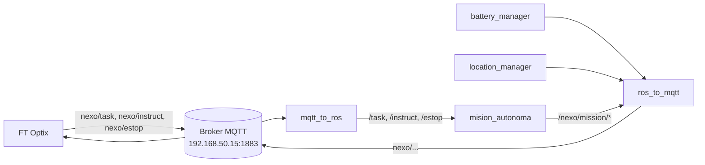

# nexo_mqtt – Puentes MQTT ↔ ROS 2 para FT Optix

Dos nodos que conectan el robot con **FT Optix** por medio de un broker MQTT:

| Nodo | Dirección | Uso |
|---|---|---|
| `mqtt_to_ros` | FT Optix → MQTT → **ROS** | Pedidos, instrucciones y paro de emergencia |
| `ros_to_mqtt` | **ROS** → MQTT → FT Optix | Batería, telemetría, pose y estado de la misión |



---

## Formato de mensajes (FT Optix)

En las dos direcciones se usa el formato de FT Optix: una marca de tiempo y una lista de *tags*.

```json
{
  "Timestamp": "2026-11-24T18:00:00.000Z",
  "Records": [
    {"TagName": "task", "Value": 2}
  ]
}
```

Los campos anidados de un mensaje de ROS se aplanan con `-`. Por ejemplo, `position-x`.

---

## `mqtt_to_ros.py` – FT Optix → ROS

### Tópicos

| Tópico MQTT | Tópico ROS | Tipo | `TagName` | Valores |
|---|---|---|---|---|
| `nexo/task` | `/task` | `std_msgs/Int32` | `task` | 1, 2 o 3 (objeto del pedido) |
| `nexo/instruct` | `/instruct` | `std_msgs/String` | `instruct` | `pausa`, `reanudar`, `cargado` |
| `nexo/estop` | `/estop` | `std_msgs/Bool` | `estop` | `true` / `false` |

### Funcionamiento
1. Se suscribe a los tópicos MQTT con QoS 1. El callback de paho solo encola el mensaje (cola de 100). El procesamiento ocurre en un timer de ROS cada 20 ms, para no publicar desde el hilo de MQTT.
2. Valida el JSON: que sea un objeto, que tenga `Timestamp` (texto) y `Records` (lista).
3. `reconstruct()` convierte los `Records` en un diccionario. El `TagName` igual al alias se convierte en el campo `data`.
4. `validar()` revisa y convierte el valor **según el tipo de mensaje**:

| Tipo | Acepta | Ejemplos válidos |
|---|---|---|
| `Bool` | bool, 0/1, `"true"`, `"false"`, `"1"`, `"0"` | `true`, `"false"`, `1` |
| `Int32`, `Int64`, `UInt16` | entero, flotante entero, texto numérico | `2`, `2.0`, `"2"` |
| `Float32`, `Float64` | número | `0.5`, `1` |
| `String` | texto | `"pausa"` |

5. Publica en ROS y registra en el log `MQTT <tópico> -> <tópico ROS>: <valor>`. Un mensaje inválido se descarta con un aviso, sin detener el nodo.

### Agregar un tópico nuevo
Basta con una línea en `MQTT_TOPICS`:
```python
MQTT_TOPICS = {
    'nexo/task': ('/task', 'std_msgs/msg/Int32', 'task'),
    'nexo/instruct': ('/instruct', 'std_msgs/msg/String', 'instruct'),
    'nexo/estop': ('/estop', 'std_msgs/msg/Bool', 'estop'),
    'nexo/velocidad': ('/nexo/velocidad_max', 'std_msgs/msg/Float32', 'velocidad'),  # ejemplo
}
```

### Cambios respecto a la versión anterior
- `BROKER` corregido de `192.168.55.15` a **`192.168.50.15`**, el mismo de `ros_to_mqtt.py`.
- La validación ya no depende del nombre del alias, sino del **tipo de mensaje**. Así se pueden agregar tópicos sin tocar el código.
- Acepta números enviados como texto o como flotante entero (`"2"`, `2.0`), que FT Optix puede mandar según cómo esté definido el tag.
- Registra cada mensaje recibido en el log.

---

## `ros_to_mqtt.py` – ROS → FT Optix

### Tópicos reenviados

| Tópico ROS | Tipo | Tópico MQTT |
|---|---|---|
| `/nexo/battery/percentage` | `Float32` | `nexo/battery/percentage` |
| `/nexo/battery/status` | `String` | `nexo/battery/status` |
| `/nexo/battery/voltage` | `Float32` | `nexo/battery/voltage` |
| `/nexo/battery/autonomy_min` | `Float32` | `nexo/battery/autonomy_min` |
| `/nexo/telemetry/speed` | `Float32` | `nexo/telemetry/speed` |
| `/nexo/telemetry/distance` | `Float32` | `nexo/telemetry/distance` |
| `/nexo/current_pose` | `PoseStamped` | `nexo/current_pose` (`position-x`, `position-y`, `orientation-yaw_deg`) |
| `/nexo/events/arrival` | `String` | `nexo/events/arrival` |
| `/nexo/mission/state` | `String` | `nexo/mission/state` |
| `/nexo/mission/object` | `Int32` | `nexo/mission/object` |
| `/nexo/mission/destination` | `String` | `nexo/mission/destination` |
| `/nexo/mission/order_source` | `String` | `nexo/mission/order_source` |
| `/nexo/mission/deliveries` | `Int32` | `nexo/mission/deliveries` |
| `/nexo/mission/event` | `String` | `nexo/mission/event` |

El tópico MQTT es el mismo de ROS sin la `/` inicial, más `PREFIX` (vacío por defecto). La pose se reduce a `x`, `y` y el yaw en grados.

### Cambios respecto a la versión anterior
- Se agregaron los 6 tópicos de la **misión autónoma** (`/nexo/mission/*`).
- El mensaje "Dato retransmitido" pasó de `info` a `debug`, para no llenar la terminal: la misión publica su estado cada 2 s.

---

## Configuración

| Variable | Archivo | Valor | Nota |
|---|---|---|---|
| `BROKER` | los dos | `192.168.50.15` | IP del broker MQTT; debe ser igual en los dos |
| `bind_address` | `ros_to_mqtt.py` | `192.168.50.20` | IP del robot en la red del broker |
| `PREFIX` | `ros_to_mqtt.py` | `''` | Prefijo opcional para los tópicos de salida |
| Puerto | los dos | 1883 | |
| `client_id` | | `nexo_ros_in` / `nexo_ros_out` | Distintos para no desconectarse entre sí |

Dependencia: `paho-mqtt` (`pip install paho-mqtt`), además de `rclpy`, `std_msgs` y `rosidl_runtime_py`.

---

## Uso

```bash
nexo
cd ~/shared/nexo_ws
colcon build --symlink-install --packages-select nexo_mqtt
source install/setup.zsh
```

Cada uno en su pestaña:
```bash
nexo
ros2 run nexo_mqtt mqtt_to_ros
```
```bash
nexo
ros2 run nexo_mqtt ros_to_mqtt
```

### Probar sin FT Optix
Con `mosquitto-clients` instalado en una PC de la misma red:

```bash
# Mandar un pedido (objeto 2)
mosquitto_pub -h 192.168.50.15 -t nexo/task -q 1 \
  -m '{"Timestamp":"2026-11-24T18:00:00.000Z","Records":[{"TagName":"task","Value":2}]}'

# Pausa / reanudar
mosquitto_pub -h 192.168.50.15 -t nexo/instruct -q 1 \
  -m '{"Timestamp":"2026-11-24T18:00:00.000Z","Records":[{"TagName":"instruct","Value":"pausa"}]}'

# Paro de emergencia
mosquitto_pub -h 192.168.50.15 -t nexo/estop -q 1 \
  -m '{"Timestamp":"2026-11-24T18:00:00.000Z","Records":[{"TagName":"estop","Value":true}]}'

# Ver todo lo que publica el robot
mosquitto_sub -h 192.168.50.15 -t 'nexo/#' -v
```

Del lado del robot, para confirmar que llegó:
```bash
ros2 topic echo /task
```

---

## Solución de problemas

| Síntoma | Revisar |
|---|---|
| No llega nada a ROS | `BROKER` correcto; el broker responde (`mosquitto_sub -h <broker> -t '#'`); la terminal de `mqtt_to_ros` no muestra error de conexión |
| `Invalid message on nexo/...` | Formato JSON: `Timestamp` como texto, `Records` como lista, `TagName` igual al alias |
| `ros_to_mqtt` no conecta | `bind_address` debe ser una IP que el robot tenga en esa red (`ip addr`) |
| Llegan datos duplicados o se desconecta | Dos nodos con el mismo `client_id` |
