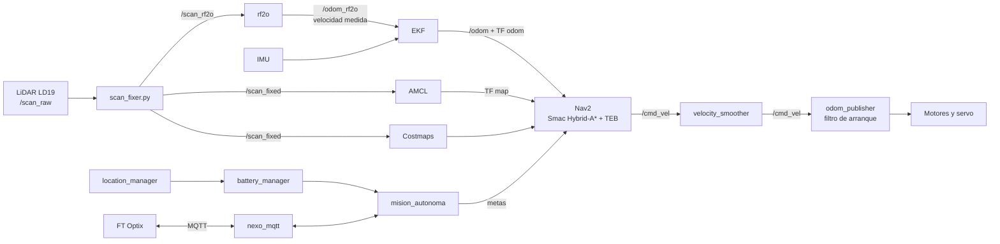

# Nexo – AMR de almacén sobre MentorPi A1 (Ackermann)

Robot móvil autónomo para un almacén a escala, construido sobre el **Hiwonder MentorPi A1** (chasis Ackermann, LiDAR LD19, Raspberry Pi) con **ROS 2 Humble** y **Nav2**.

El robot recoge paquetes en *Inicio*, los lleva al almacén que corresponde, regresa por otro y se desvía a una estación de carga cuando la batería no alcanza. Recibe pedidos y reporta su estado a **FT Optix** por **MQTT**.

| Documento | Contenido |
|---|---|
| Este README | Arquitectura, puesta en marcha, configuración y solución de problemas |
| [`nexo_mentorpi/README_mision_autonoma.md`](nexo_mentorpi/README_mision_autonoma.md) | Misión autónoma (`mision_autonoma.py`) |
| [`nexo_mqtt/README.md`](nexo_mqtt/README.md) | Puentes MQTT ↔ ROS (`mqtt_to_ros.py`, `ros_to_mqtt.py`) |

---

## Arquitectura



- **Planificador global:** Smac Hybrid-A\* con Reeds-Shepp y radio de giro de 0.35 m.
- **Controlador local:** TEB, configurado para Ackermann.
- **Localización:** AMCL sobre el mapa del almacén. La odometría es un EKF que fusiona la velocidad medida por rf2o con el giro de la IMU.

---

## Estructura

Hay dos workspaces dentro del contenedor del robot:

| Workspace | Qué contiene | Ruta |
|---|---|---|
| `ros2_ws` | Paquetes del fabricante (driver, navegación, SLAM) | `~/ros2_ws` (dentro del contenedor) |
| `nexo_ws` | **Este repositorio** | `~/shared/nexo_ws` |

```
nexo_ws/src/
├── nexo_mentorpi/
│   ├── config/
│   │   ├── nexo_nav2_params.yaml   # Parámetros de Nav2 (AMCL, costmaps, Smac, smoother, BT)
│   │   └── nexo_bt.xml             # Behavior tree sin Spin (Ackermann)
│   ├── launch/nexo_nav.launch.py   # Robot + Nav2 con el mapa y parámetros propios
│   ├── maps/                       # map_equipo3_alamcen_ed (original) y _zona (zona cerrada)
│   └── nexo_mentorpi/
│       ├── mision_autonoma.py      # Ciclo autónomo de entregas
│       ├── smac_navigator.py       # Navegación manual por menú
│       ├── battery_manager.py      # % de batería, estado y autonomía
│       └── location_manager.py     # Pose, velocidad, distancia y llegada a estaciones
└── nexo_mqtt/
    └── nexo_mqtt/
        ├── mqtt_to_ros.py          # FT Optix -> ROS
        └── ros_to_mqtt.py          # ROS -> FT Optix
```

Scripts de apoyo en `~/shared` (fuera del workspace):

| Script | Uso |
|---|---|
| `scan_fixer.py` | Remuestrea `/scan_raw` a un número fijo de puntos: `/scan_fixed` (Nav2) y `/scan_rf2o` (rf2o, de −180° a +180°). |
| `rf2o_scan_fixed.launch.py` | rf2o leyendo `/scan_rf2o`. Publica `/odom_rf2o` sin TF. |
| `path_relay.py` | Copia `/plan` → `/plan_viz` con `frame_id` en cada pose, para Foxglove. |
| `editar_mapa.py` | Bloquea o libera rectángulos del mapa `.pgm`. |
| `ajustar_arranque.py` | Filtro de velocidad mínima e impulso de arranque en el driver. |
| `configurar_robot.py` | EKF con velocidad de rf2o y giro de la IMU. |

---

## Entorno

- El robot corre ROS dentro de un **contenedor Docker**. `~/shared` dentro del contenedor es `/home/pi/docker/tmp` en la Raspberry. Ahí se copian archivos con WinSCP.
- **`ROS_DOMAIN_ID=3`**: evita mezclarse con otros robots del laboratorio, que usan el dominio 0.
- Alias en `~/.zshrc`, para empezar cada terminal:

```bash
alias nexo='source /opt/ros/humble/setup.zsh && source ~/ros2_ws/install/setup.zsh && source ~/shared/nexo_ws/install/setup.zsh && export ROS_DOMAIN_ID=3'
```

---

## Compilar

```bash
nexo
cd ~/shared/nexo_ws
colcon build --symlink-install --packages-select nexo_mentorpi nexo_mqtt
source install/setup.zsh
ros2 pkg executables nexo_mentorpi
```

Debe listar `battery_manager`, `location_manager`, `mision_autonoma` y `smac_navigator`.

> **Importante:** en paquetes Python, `--symlink-install` enlaza los `.py`, pero **copia** los `yaml`, mapas y launch a `install/`. **Después de editar cualquier `yaml`, mapa o launch hay que recompilar.** Los `.py` no necesitan recompilar.

---

## Puesta en marcha

Cada pestaña empieza con `nexo`.

### 0. Preparar
```bash
nexo
~/.stop_ros.sh
echo $ROS_DOMAIN_ID       # debe ser 3
```

### 1–5. Sistema base

| Pestaña | Comando | Nota |
|---|---|---|
| 1 | `ros2 launch nexo_mentorpi nexo_nav.launch.py use_teb:=true 2>&1 \| tee ~/shared/nav_log.txt` | Robot y Nav2. El log queda en `nav_log.txt`. |
| 2 | `cd ~/shared && python3 scan_fixer.py` | Arrancar en los primeros 10 s. |
| 3 | `ros2 launch ~/shared/rf2o_scan_fixed.launch.py` | Arrancar enseguida. El EKF depende de rf2o. |
| 4 | `ros2 launch rosbridge_server rosbridge_websocket_launch.xml` | Para Foxglove. |
| 5 | `cd ~/shared && python3 path_relay.py` | Para ver la ruta en Foxglove. |

### 6–7. Nodos del proyecto
```bash
ros2 run nexo_mentorpi battery_manager
```
```bash
ros2 run nexo_mentorpi location_manager
```

### 8. Modo de operación (solo uno a la vez)

| Modo | Comando |
|---|---|
| **Autónomo** | `ros2 run nexo_mentorpi mision_autonoma` |
| Manual (menú) | `ros2 run nexo_mentorpi smac_navigator` |

### 9–10. Puentes MQTT (FT Optix)
```bash
ros2 run nexo_mqtt mqtt_to_ros
```
```bash
ros2 run nexo_mqtt ros_to_mqtt
```

### Paro de emergencia
```bash
nexo
ros2 service call /navigate_to_pose/_action/cancel_goal action_msgs/srv/CancelGoal "{}"; ros2 topic pub -w 1 -t 5 /cmd_vel geometry_msgs/msg/Twist "{}"
```
Con la misión autónoma corriendo, también sirve `ros2 topic pub --once /estop std_msgs/msg/Bool "{data: true}"`.

### Foxglove
1. Conectar a `ws://<IP_DEL_ROBOT>:9090`.
2. Suscribirse solo a lo necesario, para no cargar rosbridge: `/map`, `/global_costmap/costmap`, `/scan_fixed` y `/plan_viz`.
3. Confirmar que el láser coincide con las paredes. Si no, usar **2D Pose Estimate**.

---

## Verificación al arrancar

A los ~40 s de lanzar la Pestaña 1:

```bash
nexo
grep "Loading yaml" ~/shared/nav_log.txt              # mapa cargado (..._zona.yaml)
ros2 lifecycle get /bt_navigator                       # active [3]
ros2 param get /controller_server failure_tolerance    # 0.3
ros2 param get /amcl update_min_d                      # 0.1
ros2 node list | sort | uniq -d                        # vacío (o solo /rf2o_laser_odometry)
ros2 topic hz /scan_fixed --window 10                  # ~10 Hz
uptime                                                 # load average < 4
```

Revisión de la odometría: empuja el robot unos 30 cm y compara antes y después.
```bash
ros2 topic echo /odom --field pose.pose.position --once
```

Revisión de toda la configuración guardada:
```bash
grep -nE "default_nav_to_pose_bt_xml|max_particles|update_min_d|max_velocity|inflation_radius|footprint:" ~/shared/nexo_ws/install/nexo_mentorpi/share/nexo_mentorpi/config/nexo_nav2_params.yaml
grep -nE "RateController|Wait|Spin|BackUp" ~/shared/nexo_ws/src/nexo_mentorpi/config/nexo_bt.xml
grep -nE "failure_tolerance|xy_goal_tolerance|max_vel_x|feasibility_check_no_poses|min_obstacle_dist" ~/ros2_ws/install/navigation/share/navigation/config/nav2_controller_teb.yaml
diff ~/ros2_ws/src/navigation/config/nav2_controller_teb.yaml ~/ros2_ws/install/navigation/share/navigation/config/nav2_controller_teb.yaml
diff ~/ros2_ws/src/driver/controller/config/ekf.yaml ~/ros2_ws/install/controller/share/controller/config/ekf.yaml
python3 ~/shared/configurar_robot.py --verificar      # CONFIGURACION P5 APLICADA
python3 ~/shared/ajustar_arranque.py --verificar      # VMIN=0.3 VMAX=0.35 KICK=0.4 KICK_T=0.3
```

---

## Estaciones

| # | Nombre | x | y | Tipo |
|---|---|---|---|---|
| 1 | Est C1 | 1.65 | 4.10 | Carga |
| 2 | Est C2 | 0.49 | 0.00 | Carga |
| 3 | Est C3 | 7.91 | 0.00 | Carga |
| 4 | Alm 1 | 3.83 | 4.32 | Almacén (objeto 1) |
| 5 | Alm 2 | 3.82 | 0.75 | Almacén (objeto 2) |
| 6 | Alm 3 | 8.98 | 1.12 | Almacén (objeto 3) |
| 7 | AGV Pool | 0.00 | 0.00 | Inicio de turno |
| 8 | Inicio | 0.79 | 4.14 | Recogida de paquetes |

Las coordenadas se capturan en Foxglove con **Publish point**, mientras corre:
```bash
ros2 topic echo /clicked_point --field point
```

---

## Mapa y zona prohibida

- **Mapa original:** `map_equipo3_alamcen_ed` (299 × 346 px, 0.05 m/px, origen −1.54, −6.41).
- **Mapa en uso:** `map_equipo3_alamcen_zona`. Es el original con la zona x 2.00–5.08, y 1.45–3.42 bloqueada.

Regenerar el mapa con la zona cerrada:
```bash
nexo
cd ~/shared/nexo_ws/src/nexo_mentorpi/maps
python3 ~/shared/editar_mapa.py map_equipo3_alamcen_ed.yaml map_equipo3_alamcen_zona --bloquear 2.00 1.45 5.08 3.42
cd ~/shared/nexo_ws && colcon build --symlink-install --packages-select nexo_mentorpi
```

Usar otro mapa sin cambiar el default:
```bash
ros2 launch nexo_mentorpi nexo_nav.launch.py use_teb:=true map:=map_equipo3_alamcen_ed
```

> Si AMCL se desfasa al pasar junto a la zona rellena, se puede bloquear solo el contorno con cuatro `--bloquear` de 10 cm de grosor. El robot tampoco entra, y el láser sigue "viendo" el interior.

---

## Configuración de navegación aplicada

### `nexo_nav2_params.yaml` (este repo)

| Parámetro | Valor | Motivo |
|---|---|---|
| Planner | `SmacPlannerHybrid`, `REEDS_SHEPP`, `minimum_turning_radius: 0.35` | Rutas que un Ackermann puede seguir. |
| `footprint` (costmaps) | rectángulo 0.25 × 0.20 m | Forma real del robot. |
| `inflation_radius` | 0.28, `cost_scaling_factor: 5.0` | Margen de seguridad sin tapar estaciones. |
| `scan_topic` / costmaps | `/scan_fixed` | Escaneo con número fijo de puntos. |
| AMCL | 1500/300 partículas, `update_min_d/a: 0.1` | Corrige la localización cada 10 cm o ~6°. |
| Costmap local | `resolution: 0.05`, `publish_voxel_map: False` | Menos CPU. |
| `velocity_smoother` | `max [0.36, 0, 1.0]`, `min [-0.31, 0, -1.0]`, `velocity_timeout: 0.5` | No recorta las velocidades de TEB. |
| `default_nav_to_pose_bt_xml` | `nexo_bt.xml` | BT propio. |

### `nexo_bt.xml`
- **Sin `Spin`:** un Ackermann no gira en su lugar.
- **Replanea cada 5 s** (`RateController hz="0.2"`), no cada 1 s. Smac Hybrid es pesado en la Pi, y replanear seguido cambiaba la ruta a media marcha.
- Recuperaciones: limpiar costmaps, `Wait 3 s` y `BackUp 0.30 m`.

### Paquetes del fabricante (`ros2_ws`, dentro del contenedor)

| Archivo | Cambio | Cómo se aplicó |
|---|---|---|
| `navigation/config/nav2_controller_teb.yaml` | `max_vel_x: 0.35`, `max_vel_x_backwards: 0.30`, `min_obstacle_dist: 0.10`, `feasibility_check_no_poses: 2`, `failure_tolerance: 0.3`, `xy_goal_tolerance: 0.15`, `yaw_goal_tolerance: 0.6`, `required_movement_radius: 0.25` | `sed` en `src` y copia a `install` |
| `driver/controller/config/ekf.yaml` | `frequency: 30.0`; fusiona vx/vy de rf2o y el giro de la IMU, no la velocidad ordenada | `configurar_robot.py` y copia a `install` |
| `driver/controller/controller/odom_publisher_node.py` | Filtro de arranque: VMIN 0.30, VMAX 0.35, impulso 0.40 m/s × 0.3 s | `ajustar_arranque.py 0.30 0.35 0.40 0.3` |

> Estos archivos viven **dentro del contenedor**. Si el contenedor se recrea, se pierden: vuelve a aplicarlos o restáuralos del respaldo.

---

## Solución de problemas

| Síntoma | Causa | Solución |
|---|---|---|
| Un cambio en un `yaml` o en el mapa no tiene efecto | `install/` tiene una copia vieja | `colcon build --packages-select nexo_mentorpi` |
| `bt_navigator` en `unconfigured` | Error en el XML del BT | Revisar las líneas `[ERROR]` en `nav_log.txt` |
| Nodos duplicados en `ros2 node list` | Otro robot en el mismo dominio, o procesos viejos | `ROS_DOMAIN_ID=3` y limpieza con `pkill` |
| `Extrapolation Error` con la misma hora repetida | Meta con `header.stamp` fijo | No poner estampa en las metas |
| El robot avanza, se para y retrocede | Spin en el BT, o TEB `trajectory is not feasible` | BT sin Spin y parámetros de TEB de la tabla |
| El láser no coincide con el mapa | Deriva de localización | 2D Pose Estimate; revisar el EKF y AMCL |
| La odometría no cambia al mover el robot | rf2o o scan_fixer apagados | Levantar las Pestañas 2 y 3 |
| `ros2 topic pub` no mueve el robot | Publica antes de conectarse | Usar `-w 1` |

Errores de Nav2 durante una prueba:
```bash
grep -E "\[(controller_server|planner_server|bt_navigator|behavior_server)\]" ~/shared/nav_log.txt | grep -E "WARN|ERROR" | tail -30
```

Limpieza completa si quedaron procesos colgados:
```bash
stop_ros
ros2 daemon stop
pkill -9 -f mision_autonoma; pkill -9 -f smac_navigator; pkill -9 -f location_manager; pkill -9 -f battery_manager
pkill -9 -f rf2o; pkill -9 -f component_container; pkill -9 -f scan_fixer
pkill -9 -f path_relay; pkill -9 -f rosbridge; pkill -9 -f rosapi; pkill -9 -f ldlidar
rm -f /dev/shm/fastrtps_* /dev/shm/sem.fastrtps_*
```

---

## Respaldo

```bash
cd ~
tar --exclude='build' --exclude='install' --exclude='log' --exclude='__pycache__' --exclude='core' \
  -czf ~/shared/respaldo_nexo_$(date +%Y%m%d).tar.gz \
  shared/nexo_ws/src shared/*.py shared/*.launch.py shared/*.sh \
  ros2_ws/src/navigation/config ros2_ws/src/navigation/launch \
  ros2_ws/src/driver/controller/config \
  ros2_ws/src/driver/controller/controller/odom_publisher_node.py \
  ros2_ws/src/slam/config .zshrc 2>/dev/null
```
El archivo queda en `/home/pi/docker/tmp/` de la Raspberry, listo para bajarlo con WinSCP.
