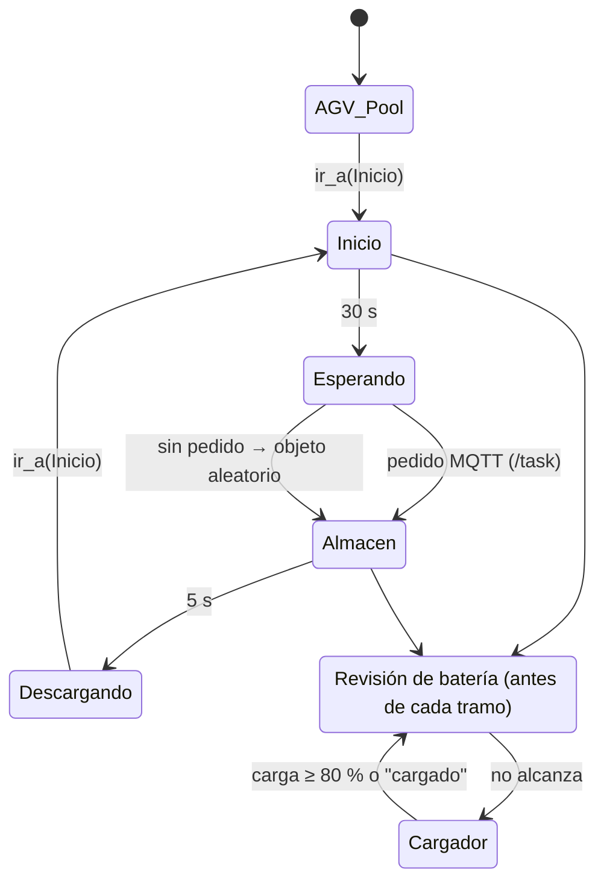

# Misión autónoma – `mision_autonoma.py`

Nodo que hace funcionar al robot **sin intervención**: recoge paquetes en *Inicio*, los entrega en el almacén que corresponde, regresa por otro y, antes de cada tramo, revisa si la batería alcanza. Si no alcanza, se desvía al cargador más cercano.

Usa Nav2 por medio de `BasicNavigator` (`nav2_simple_commander`). Tanto los recorridos (`goToPose`) como el cálculo de distancias para la batería (`getPath`) usan el mismo planificador **Smac Hybrid-A\*** y el controlador **TEB**, así que las distancias son las de la ruta real.

---

## Ciclo



| Objeto | Almacén |
|---|---|
| 1 | Alm 1 (3.83, 4.32) |
| 2 | Alm 2 (3.82, 0.75) |
| 3 | Alm 3 (8.98, 1.12) |

1. Al arrancar, espera a Nav2 y a la primera pose de AMCL, y va de **AGV Pool a Inicio**.
2. En **Inicio** espera hasta **30 s** un pedido por MQTT (`/task`). Si el pedido llegó mientras el robot venía en camino, lo usa de inmediato. Si no llega ninguno, elige un objeto al azar.
3. Va al almacén del objeto, espera **5 s** (descarga) y suma una entrega.
4. Regresa a Inicio y repite.

---

## Lógica de batería

Antes de cada tramo calcula la ruta con Nav2 y estima:

```
energía necesaria = K_PCT_PER_M × distancia_ruta + RESERVA_PCT
```

Si el destino **no** es un cargador, también suma el tramo **destino → cargador más cercano**. Así el robot nunca llega a un almacén sin poder ir después a cargar.

| Situación | Acción |
|---|---|
| `batería ≥ necesaria` | Va al destino. |
| No alcanza y ya está en un cargador | Espera carga. |
| No alcanza | Va al cargador más cercano **por ruta** al que llega con reserva (o, si ninguno, al más cercano al que llega sin reserva), espera carga y vuelve a evaluar. |
| No alcanza ningún cargador | Estado `SIN_BATERIA`; espera que lo lleven a cargar y la instrucción `cargado`. |
| El tramo requiere más de 100 % | Se reporta como imposible (`ERROR`). |

**Carga:** espera hasta `max(PCT_CARGADO, necesaria + 5)` o hasta recibir la instrucción `cargado`. La batería real solo sube si se conecta el cargador.

---

## Interfaz ROS

### Entradas

| Tópico | Tipo | Valores | Origen |
|---|---|---|---|
| `/task` | `std_msgs/Int32` | 1, 2 o 3 | FT Optix (`nexo/task`) |
| `/instruct` | `std_msgs/String` | `pausa`, `reanudar`, `cargado` | FT Optix (`nexo/instruct`) |
| `/estop` | `std_msgs/Bool` | `true` = paro, `false` = liberar | FT Optix (`nexo/estop`) |
| `/nexo/battery/percentage` | `std_msgs/Float32` | % | `battery_manager` |
| `/nexo/battery/status` | `std_msgs/String` | `OK`, `LOW_BATTERY_RETURN`… | `battery_manager` |
| `/amcl_pose` | `PoseWithCovarianceStamped` | pose en `map` | AMCL |

### Salidas (cada 2 s y en cada cambio)

| Tópico | Tipo | Contenido |
|---|---|---|
| `/nexo/mission/state` | `String` | Estado actual (tabla de abajo) |
| `/nexo/mission/object` | `Int32` | Objeto en curso (0 = ninguno) |
| `/nexo/mission/destination` | `String` | Destino actual |
| `/nexo/mission/order_source` | `String` | `MQTT` o `ALEATORIO` |
| `/nexo/mission/deliveries` | `Int32` | Entregas completadas |
| `/nexo/mission/event` | `String` | Eventos en texto (llegadas, desvíos, errores) |

`ros_to_mqtt.py` reenvía estas salidas a FT Optix como `nexo/mission/...`.

### Estados

| Estado | Significado |
|---|---|
| `ESPERANDO_NAV2` | Esperando a Nav2 y a AMCL |
| `PLANEANDO` | Calculando ruta y energía |
| `NAVEGANDO_A_<DESTINO>` | En camino |
| `ESPERANDO_PEDIDO` | En Inicio, esperando `/task` (máx. 30 s) |
| `DESCARGANDO` | En el almacén (5 s) |
| `CARGANDO` | En un cargador, esperando carga |
| `PAUSA` / `PARO_EMERGENCIA` | Detenido por `/instruct` o `/estop` |
| `SIN_BATERIA` | No alcanza ningún cargador |
| `ERROR` | No pudo llegar tras los reintentos; espera `reanudar` |

---

## Pausa, paro y errores

- **`/estop true` o `pausa`:** cancela la meta en curso, detiene el robot y espera. Con `/estop false` o `reanudar`, reenvía la misma meta. Una interrupción no cuenta como fallo.
- **Durante la espera de pedido,** la pausa no consume los 30 s.
- **Si Nav2 falla un tramo,** reintenta 2 veces. Si no encuentra ruta, reintenta 3 veces cada 3 s. Si aun así no llega, pasa a `ERROR` y espera `reanudar` para volver a intentar el **mismo** tramo.
- **Llegada:** da por llegada la meta al entrar a **15 cm**, para evitar maniobras finas de un Ackermann.
- **Orientación:** las estaciones con `yaw = None` se orientan en la dirección de llegada. Así Smac no planea vueltas de ida y regreso para encarar +x. AGV Pool usa `yaw = 0.0`.
- **Metas sin estampa de tiempo:** TF usa la transformación más reciente. Una estampa fija hacía fallar las rutas largas.

---

## Configuración

Constantes al inicio de `mision_autonoma.py`. Al ser un `.py` con `--symlink-install`, basta con guardar y relanzar el nodo, sin recompilar.

| Constante | Valor | Descripción |
|---|---|---|
| `ESTACIONES` | ver archivo | `(nombre, x, y, yaw)`; `yaw=None` = dirección de llegada |
| `ESTACIONES_CARGA` | `'1','2','3'` | Cargadores |
| `INICIO`, `AGV_POOL` | `'8'`, `'7'` | Estaciones fijas |
| `OBJETO_A_ALMACEN` | `{1:'4', 2:'5', 3:'6'}` | Objeto → almacén |
| `T_ESPERA_PEDIDO` | 30 s | Espera de pedido en Inicio |
| `T_DESCARGA` | 5 s | Tiempo en el almacén |
| `K_PCT_PER_M` | 4.0 | % de batería por metro |
| `RESERVA_PCT` | 20 | % mínimo al llegar |
| `PCT_CARGADO` | 80 | % con el que sale del cargador |
| `TOLERANCIA_LLEGADA_M` | 0.15 | Margen de llegada |
| `REINTENTOS_NAV` / `REINTENTOS_RUTA` | 2 / 3 | Reintentos antes de `ERROR` |

---

## Uso

Requisitos: el sistema base corriendo (Nav2, scan_fixer, rf2o, rosbridge y path_relay; ver el [README principal](../README.md)), más `battery_manager` y `location_manager`. **No correr `smac_navigator` al mismo tiempo**, porque los dos mandarían metas a Nav2.

```bash
nexo
ros2 run nexo_mentorpi mision_autonoma
```

Seguir lo que hace:
```bash
nexo
ros2 topic echo /nexo/mission/event --field data
```

### Probar sin FT Optix
```bash
ros2 topic pub --once /task std_msgs/msg/Int32 "{data: 2}"            # pedido: objeto 2
ros2 topic pub --once /instruct std_msgs/msg/String "{data: pausa}"
ros2 topic pub --once /instruct std_msgs/msg/String "{data: reanudar}"
ros2 topic pub --once /instruct std_msgs/msg/String "{data: cargado}"  # terminar la carga
ros2 topic pub --once /estop std_msgs/msg/Bool "{data: true}"
ros2 topic pub --once /estop std_msgs/msg/Bool "{data: false}"
```

Para forzar un desvío a cargar en una prueba, sube temporalmente `RESERVA_PCT` (por ejemplo a 60).

---

## Instalación

1. Copiar `mision_autonoma.py` a `nexo_mentorpi/nexo_mentorpi/`.
2. Registrar el ejecutable en `nexo_mentorpi/setup.py`:
   ```python
   'mision_autonoma = nexo_mentorpi.mision_autonoma:main',
   ```
3. Compilar:
   ```bash
   cd ~/shared/nexo_ws
   colcon build --symlink-install --packages-select nexo_mentorpi
   source install/setup.zsh
   ros2 pkg executables nexo_mentorpi    # debe listar mision_autonoma
   ```

---

## Limitaciones

- El consumo de batería es un modelo lineal (`K_PCT_PER_M`). El porcentaje real viene del voltaje (`battery_manager`).
- La "carga" depende de que alguien conecte el cargador o mande `cargado`.
- Si el robot tiene que desviarse a cargar, lo hace con el paquete a bordo.
